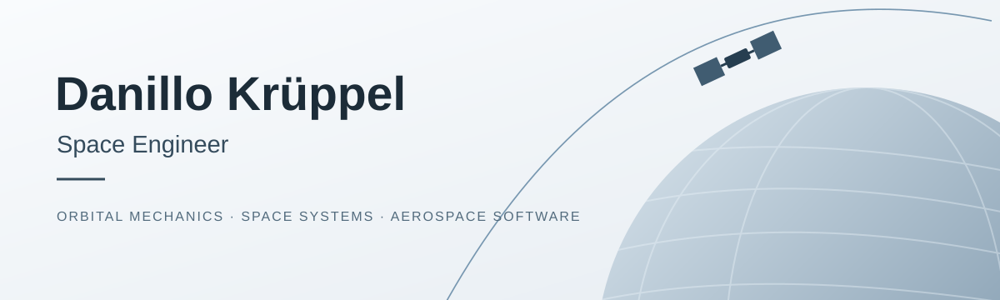

**Space Engineering · Modelling & Simulation · Aerospace Software**

[Projects](#featured-projects) · [Technical expertise](#technical-expertise) · [Tools](#tools--technologies) · [Contact](#contact)

## About me

I'm a space engineer with experience in orbital mechanics, aerospace modelling and simulation, space systems, and engineering software. My work combines analytical problem-solving with practical implementation, from satellite mission analysis to aircraft collision-avoidance algorithms and nanosatellite hardware design.

This profile is a curated selection of my technical work, with an emphasis on **methodology, reproducibility, and engineering results**.

## Featured projects

<table>
<tr>
<td width="33%" valign="top">

 <strong>Satellite Revisit Time</strong> 
Investigating how orbital altitude influences observation revisit time over Central Europe.  
Orbital mechanics · Numerical analysis 
<a href="https://github.com/dkruppel-ux/Effect-of-Orbital-Altitude-on-Satellite-Revisit-Time-over-Central-Europe">View repository →</a>
</td>
<td width="33%" valign="top">

 <strong>Aircraft Collision Avoidance</strong> 
Development of detection and avoidance algorithms informed by ACAS/TCAS principles.  
MATLAB · Python · Algorithms 
<em>Technical overview available on request</em>
</td>
<td width="33%" valign="top">

 <strong>Nanosatellite Support Systems</strong> 
Mechanical support concepts and a vibration-testing capsule for nanosatellite applications.  
SolidWorks · Mechanical design 
<em>Technical overview available on request</em>
</td>
</tr>
</table>

> Project graphics are conceptual illustrations, not measured results or actual hardware photographs. For detailed results, see the linked project repository.

## Technical expertise

| Discipline | Selected experience |
|:--|:--|
| **Astrodynamics** | Orbital mechanics, orbit propagation, satellite visibility, revisit analysis |
| **Space systems** | Nanosatellite support systems, systems engineering, technical documentation |
| **Modelling & simulation** | Aerospace simulations, numerical modelling, scenario analysis |
| **Aerospace software** | Collision avoidance algorithms, data processing, engineering tools |
| **Satellite communications** | Link budgets, Doppler analysis, ground-station visibility |
| **Embedded & real-time** | Ada, C, ARINC-653 concepts, XtratuM |

## Tools & technologies

**Programming:** `Python` · `MATLAB` · `C` · `Ada`  
**Mission analysis:** `GMAT` · `Ansys STK`  
**Engineering & design:** `SolidWorks` · `Systems Engineering` · `ECSS`  
**Version control:** `Git` · `GitHub`

## Contact

Interested in space systems, orbital mechanics, aerospace software, and technical collaboration.

- [GitHub profile](https://github.com/dkruppel-ux)
- LinkedIn: *add your public profile URL*
- Email: *add your preferred professional contact address*
- CV: *add a PDF in this repository and link it here, if desired*

---

Designed as a lightweight, GitHub-native engineering portfolio. No external website or JavaScript required.
