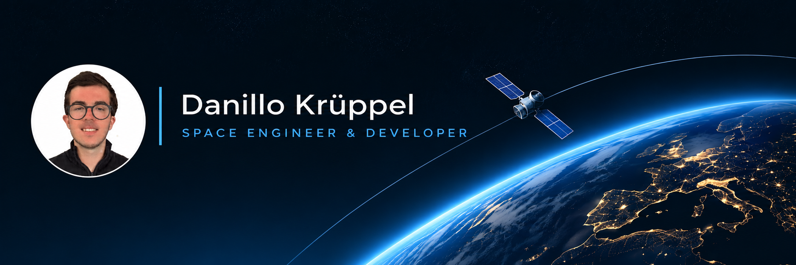
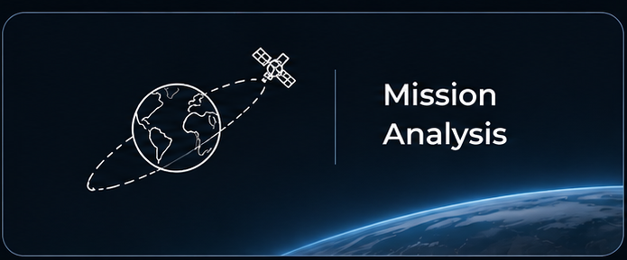
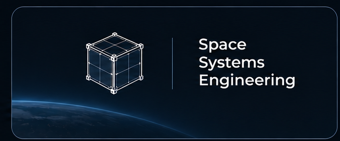
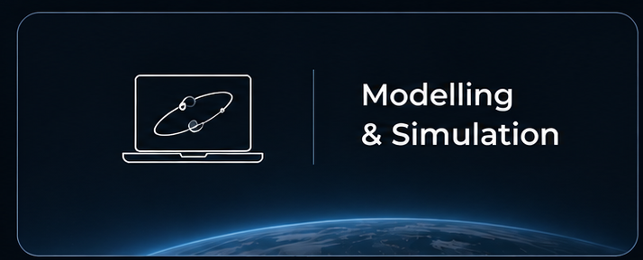

**Space Engineering · Aerospace Software · Modelling & Simulation**

[Expertise](#areas-of-expertise) · [Projects](#selected-engineering-work) · [Technical skills](#technical-skills) · [Contact](#contact)

## About me

I'm a space engineer and developer working across orbital mechanics, aerospace modelling and simulation, space systems, and engineering software. My experience spans satellite mission analysis, aircraft collision-avoidance algorithms, and nanosatellite support-system design.

I focus on turning engineering concepts into practical, well-documented technical solutions.

## Areas of expertise

<table><tr>
<td width="33%" align="center"></td>
<td width="33%" align="center"></td>
<td width="33%" align="center"></td>
</tr></table>

### Mission Analysis
Orbital mechanics, satellite tracking, visibility, ground-station passes, and revisit-time analysis.

### Space Systems Engineering
Spacecraft and nanosatellite support concepts, systems-engineering documentation, and mechanical design.

### Modelling & Simulation
Numerical analysis, aerospace algorithms, engineering simulations, and reproducible computational workflows.

## Selected engineering work

### Satellite revisit time over Central Europe
Investigating how orbital altitude affects observation revisit time, with numerical analysis and visualization.

[**Explore the project and code**](https://github.com/dkruppel-ux/Effect-of-Orbital-Altitude-on-Satellite-Revisit-Time-over-Central-Europe)

### Aircraft collision avoidance algorithms
Development of collision-detection and avoidance algorithms using MATLAB and Python, informed by ACAS/TCAS principles.

### Nanosatellite support systems
Design of nanosatellite handling supports and a vibration-testing capsule using SolidWorks.

## Technical skills

| Area | Tools and methods |
|:--|:--|
| **Programming** | Python, MATLAB, C, Ada |
| **Mission analysis** | GMAT, Ansys STK, orbital mechanics, satellite visibility |
| **Engineering design** | SolidWorks, systems engineering, ECSS-related documentation |
| **Space communications** | Link budgets, Doppler effects, ground-station analysis |
| **Embedded systems** | Real-time software, XtratuM, ARINC-653 |

## Contact

[GitHub](https://github.com/dkruppel-ux) · [LinkedIn](https://www.linkedin.com/in/danillokruppel) · Email: dkruppel@gmail.com · [CV](https://drive.google.com/file/d/1Xp9AaX0sSx-1x_yZmvGRgk5wLO0coQpj/view?usp=sharing)

---
GitHub-native portfolio · Custom visuals · No separate website required
